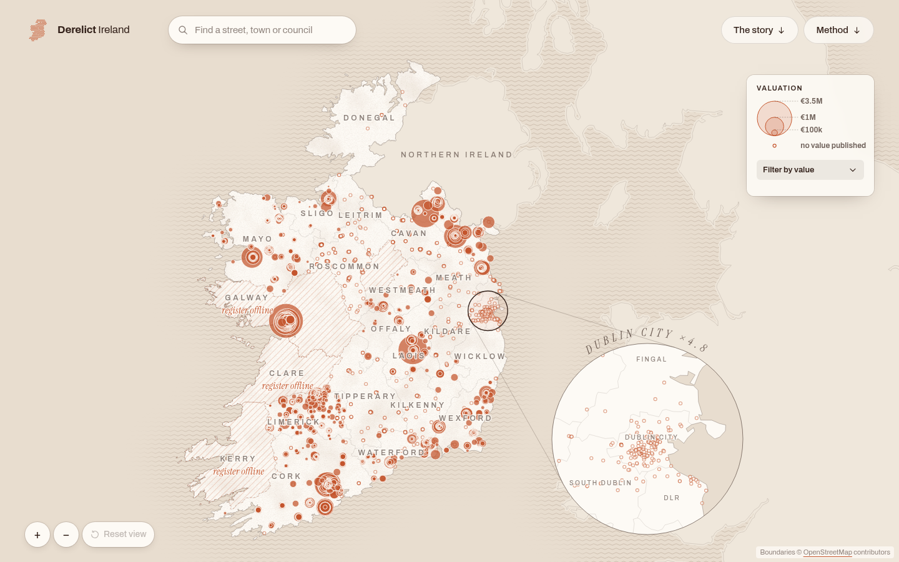

# Derelict Ireland

Every council in Ireland has to keep a public register of derelict sites. The trouble is they're scattered across PDFs, spreadsheets, web tables and map portals, each in its own format. This project gathers them up and puts every site on one map, with a short essay underneath about what the registers show.

**Live site:** https://acoci86.github.io/derelict-ireland/



27 of the 31 councils publish their register online, and they're all here: 2,364 sites on the map, with about 260 more I couldn't place. Kerry, Longford, Clare and Galway County keep theirs offline (you have to ask or visit the office), so they're hatched on the map. Cavan joined in September 2026.

You can hover over or tap any site, search for a street or town, filter by value, drag the magnifier around, and zoom in until the streets appear. Below the map, every chart is made of the same dots: one dot, one site. You can draw your guess before the real numbers drop in, drag a marker to work out a site's levy, or pull a random line from any council's register.

## How the data gets made

`npm run pipeline` reads every council's register through its own adapter in `pipeline/adapters/` and writes `public/sites.geojson` and `public/stats.json`.

Some councils publish map layers with coordinates, so those sites land exactly where the council puts them. The rest only give addresses. Their registers get scraped into a CSV once (the converters are in `pipeline/manual/`), and each address is looked up on OpenStreetMap: Nominatim first, then Photon if that finds nothing.

Photon is fuzzy. It once put "Main Street, Ringaskiddy" near the Limerick border. So every result has to land in the right county, and a Photon result also has to be within 5 km of a town the address names, or the site goes to that town instead. Anything I can't place sensibly is held back, not guessed. Lookups are cached in `data/cache/`, so re-runs are quick. Until the next pipeline run picks that check up, `data/place-fixes.json` moves the 57 sites it caught.

I never read owner or occupier details, even where a register includes them. Only the location, reference, dates and value.

`npm run check` asks each council whether its register has changed since my copy and logs the answer to `public/history.json`. Pulling an update in is still a manual step: re-run that council's converter, then the pipeline.

## Running it

```sh
npm install
npm run dev        # the site, with live reload
npm run check      # has any register changed?
npm run pipeline   # rebuild the data
npm run build      # static site in ./dist
```

The site is plain JavaScript with [d3](https://d3js.org), built by [Vite](https://vite.dev). `scripts/prepare-data.mjs` turns the pipeline's files into the small ones the page loads (`public/data/`, rebuilt on every dev and build). Pushing to `main` deploys to GitHub Pages.

A few sentences in `index.html` name particular sites (Commons Lane, the Players Lounge, Annesley Place and so on), so give them a read after a data refresh.

## Adding a council

Write an adapter in `pipeline/adapters/` (and a converter in `pipeline/manual/` if the register is a PDF or spreadsheet), add it to `ADAPTERS` in `pipeline/run.ts`, give it a county hint and bounding box in `pipeline/geocode.ts` if it needs geocoding, and run the pipeline.

## Credits, licence and a warning

The code is MIT. The data comes from the councils' registers, and the positions, boundaries and street maps come from OpenStreetMap (© OpenStreetMap contributors, ODbL), so please credit them if you reuse it. The street tiles are OpenStreetMap's own, which are fine for light use; a busy site should move to a tile provider.

The two photographs are by Smirkybec on Wikimedia Commons ([Players Lounge](https://commons.wikimedia.org/wiki/File:Players_Lounge,_Fairview_Strand,_Dublin.jpg), [Annesley Place](https://commons.wikimedia.org/wiki/File:2-4_Annesley_Place,_Dublin.jpg)), CC BY-SA 4.0. The icons were drawn for this site.

This isn't an official source. Check the council's own register before relying on anything here.
